<h3>
  
 Hi, I'm Bruno Macabeus!

</h3>

I build tools that help people turn ideas into working software. My work includes Figma integrations, code generation, and AI-powered app creation.

In my spare time, I build tools for retro game decompilation, organize [GambiConf](https://gambiconf.dev/) in Brazil, and share what I learn through talks and articles.

## 🧪&nbsp;&nbsp;&nbsp;Retro game decompilation

**Matching decompilation** means recovering source code that recompiles into the original binary, byte for byte. I'm exploring how far AI and automation can take it, and building open-source tools along the way:

<table>
  <tr>
    <td></td>
    <td>Make benchmark to evaluate matching decompilation using AI and programmatic tools.</td>
    <td>
      📄 <a href="https://gambiconf.substack.com/p/can-llms-really-do-matching-decompilation">Benchmarks post</a>
    </td>
  </tr>
  <tr>
    <td></td>
    <td>A VS Code extension for matching decompilation with AI-powered features.</td>
    <td width="25%">
      🧩 <a href="https://marketplace.visualstudio.com/items?itemName=macabeus.kappa">Marketplace</a> 
      📄 <a href="https://gambiconf.substack.com/p/development-journey-on-game-decompilation">Blog post</a>
    </td>
  </tr>
  <tr>
    <td></td>
    <td>A programmatic matching decompiler, built using an AI loop to keep improving the decompiler itself.</td>
    <td>
      🕹️ <a href="https://macabeus.github.io/asmlift/">Playground</a> 
      📊 <a href="https://macabeus.github.io/asmlift/#view=benchmark">Benchmark</a>
    </td>
  </tr>
  <tr>
    <td></td>
    <td>Mutates source code until it compiles to the target assembly, with the capability to let coding agents like Claude Code drive the search.</td>
    <td>
      ⚙️ <a href="https://github.com/macabeus/transmuter#setup">Setup guide</a>
    </td>
  </tr>
</table>

Want the full story? Watch my talk [Retro Game Decompilation Using AI](https://www.youtube.com/watch?v=sF_Yk0udbZw) or read [how I started a decompilation project](https://gambiconf.substack.com/p/starting-a-decompilation-project).

## 🧑‍💻&nbsp;&nbsp;&nbsp;More projects

<table>
  <tr>
    <td></td>
    <td>A web level editor for <i>Klonoa: Empire of Dreams</i>, and a case study for learning reverse engineering on a GBA game.</td>
    <td width="25%">
      🕹️ <a href="http://macabeus.github.io/klo-gba.js/">Editor</a> 
      📄 Posts (<a href="https://medium.com/@bruno.macabeus/reverse-engineering-a-gameboy-advance-game-introduction-ec185bd8e02">🇺🇸</a> / <a href="https://medium.com/@bruno.macabeus/pt-br-engenharia-reversa-num-jogo-de-gameboy-advance-introdu%C3%A7%C3%A3o-21ebffe2f794">🇧🇷</a> / <a href="https://macabeus.medium.com/ingenier%C3%ADa-inversa-de-un-juego-de-game-boy-advance-gu%C3%ADa-completa-dd5167f70263">🇪🇸</a>)
    </td>
  </tr>
  <tr>
    <td></td>
    <td>Compiles EventMacro, the scripting language of the OpenKore bot, to Perl plugins. A hands-on way to demystify compilers.</td>
    <td>
      🎥 <a href="https://www.youtube.com/watch?v=zMJYoYwOCd4">Talk</a>
    </td>
  </tr>
  <tr>
    <td></td>
    <td>A VS Code extension for <a href="https://projectfluent.org/">Fluent</a>, the Mozilla's localization language.</td>
    <td>
      🧩 <a href="https://marketplace.visualstudio.com/items?itemName=macabeus.vscode-fluent">Marketplace</a> 
      🎥 <a href="https://www.youtube.com/watch?v=kHHFcuQq70k&t=357s">Talk</a>
    </td>
  </tr>
</table>

## 🐒&nbsp;&nbsp;&nbsp;Community and talks

I'm the organizer of [**GambiConf**](https://gambiconf.dev/), an event in Brazil that celebrates the joyful and playful side of computing.

I also speak at events. Some of my favorite presentations:

- 🇺🇸 [Retro Game Decompilation Using AI](https://www.youtube.com/watch?v=sF_Yk0udbZw)
- 🇺🇸 [Demystifying compilers by writing your own](https://www.youtube.com/watch?v=zMJYoYwOCd4)
- 🇺🇸 [The day I reverse engineered a furry Gameboy Advance game](https://www.youtube.com/watch?v=RMM_5bq3Ct8)

[See all my talks on my website.](https://macabeus.github.io/)

## 🌐&nbsp;&nbsp;&nbsp;Connect with me

- <a href="http://macabeus.github.io/">Website</a>
- <a href="https://www.linkedin.com/in/macabeus">LinkedIn</a>
- <a href="https://gambiconf.substack.com/">Substack</a>
- <a href="https://bsky.app/profile/macabeus.bsky.social">Bluesky</a>
- <a href="https://twitter.com/bmacabeus">Twitter</a>
